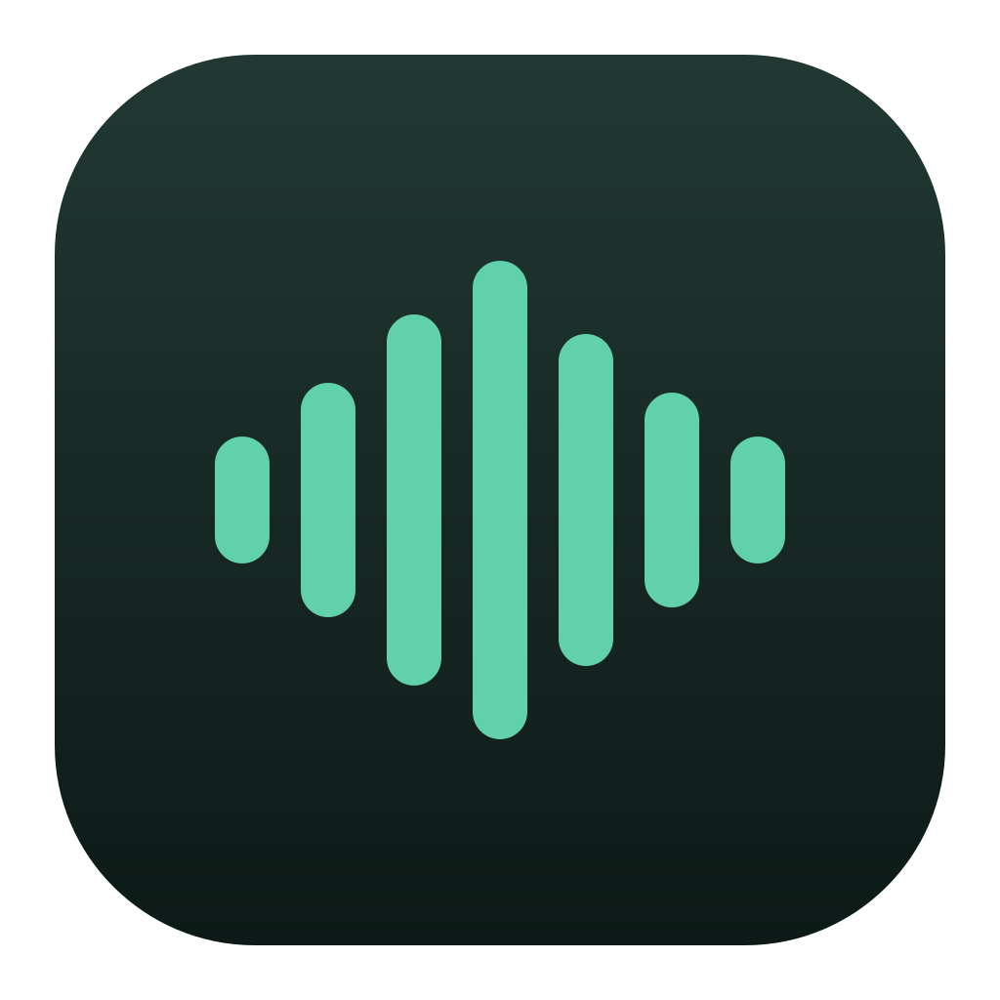

# freetalk

English · [简体中文](README.md)



**Turn spoken ideas into usable text and meeting context.**

freetalk is an open-source voice tool for Apple Silicon Macs. Dictate into your current app with local transcription and restrained cleanup. Turn meeting recordings into source-linked transcripts, basic minutes and mind maps that people—and agents such as Claude Code and Codex—can read. Welcome! Try it, report a reproducible issue, or help improve Chinese and mixed Chinese–English dictation.

[Download](https://github.com/Zacklinkk/freetalk/releases/latest) · [Getting started](docs/onboarding.md) · [Meetings and agents](docs/meetings.md) · [Report an issue](https://github.com/Zacklinkk/freetalk/issues)

> Experimental. Dictation and basic meeting processing run locally. Cloud writing requires explicit configuration. Transcripts, speaker labels and summaries can contain errors; review important content. The app interface and detailed guides are currently in Chinese.

## Speak, organize, reuse

| Your goal | What freetalk provides |
| --- | --- |
| Put an idea into an app | Tap the default **right Option** (or your custom shortcut), speak, then tap again. Remove clear stutters, fillers and spoken corrections while preserving details. A compact indicator shows the target app, level and status. Messages are never sent automatically. |
| Keep useful meeting records | Press the default **right Option + M** (customizable) to start or stop a meeting, or import audio. Generate timestamped transcripts, cited basic minutes, action items and a mind map locally. Speaker labeling is optional. |
| Give context to people and agents | Search, page through and export JSON, Markdown and mind maps with the bundled CLI. Trace conclusions to source segments. Optionally add deeper writing through OneAPI or another OpenAI-compatible service. |

## Get started

Requires **Apple Silicon and macOS 14+**. Recommended: 16 GB unified memory and 8 GB free disk space.

1. Download the macOS arm64 ZIP from [Releases](https://github.com/Zacklinkk/freetalk/releases/latest). Move `freetalk.app` to Applications or `~/Applications`.
2. Follow onboarding to allow microphone, Accessibility and Input Monitoring. Accessibility supports insertion into the selected field; Input Monitoring supports global shortcuts. [Permission guide](docs/permissions.md)
3. Download the local models. Choose Hugging Face or HF-Mirror, monitor progress, speed and ETA, and pause/retry with resumable downloads and file verification. [Model setup](docs/model-setup.md)
4. Try a sentence and compare the raw transcript, cleaned result and latency. Then focus an input field in your app and tap your shortcut (default right Option).

Public builds are not Apple-notarized. If macOS blocks the first launch, verify that the download came from this repository and follow the system's Privacy & Security instructions. Do not disable system security. Reopen the permission guide if an update invalidates access.

## Everyday dictation

- **Keep the meaning.** Clean clear repetitions, fillers and explicit self-corrections. Preserve details, negation and conditions. Use continuous paragraphs by default; explicit lists can become bullets.
- **Format numbers in context.** Quantities, versions and identifiers can use digits; ordinary Chinese words, names, ambiguous estimates, quotations and code remain protected. Context can ground the spelling of known model versions.
- **Use your vocabulary.** Personal terms are spelling candidates, not unconditional replacements. The input draft, app name and window title help disambiguation. Nearby visible text is a separate opt-in, read once with strict limits and processed locally. There is no screenshot collection or continuous background capture.
- **Learn with undo.** Reliable local corrections can suggest vocabulary entries, with an undo notice. Learning does not permanently ban a word or automatically fine-tune model weights.
- **Choose your shortcuts.** The default is a right-Option tap; meetings use right Option + M. Record a single modifier or a chord in Settings. Meeting shortcuts can follow the dictation key or be recorded separately. **Test shortcut** listens for 8 seconds and distinguishes missing permission, a consumed event and a mismatched binding without recording.
- **Control the device and duration.** Follow the system microphone or select one. Dictation limits range from 30 to 600 seconds; new users start at 3 minutes. The last 10 seconds show a countdown and a smooth mint-to-red transition, respecting Reduce Motion.
- **Find previous results.** Browse and copy the latest 500 text entries. Older entries roll off. Ordinary dictation audio is not retained.

Before inserting, freetalk checks the app, input field, draft and cursor. Switching apps, moving the cursor or editing the draft during recording may leave the result available to copy instead. Some applications still need compatibility work; please report app versions and non-private reproduction steps.

## Meetings: local basics, optional cloud writing

Enable Meetings before use. The default **right Option + M** (customizable in Settings) starts or stops microphone recording. Import WAV, M4A, MP3 or FLAC. Meeting recording has an 8-hour limit and currently does not capture system playback audio.

Local ASR and the local editor always produce the transcript, basic minutes and mind map first. An optional ~107 MB diarization model labels anonymous speakers within the meeting and overlapping segments. It does not identify real people or reliably recover every simultaneously spoken word.

Expand **Cloud deep editing and writing** in meeting options. Save an OpenAI-compatible API base URL, model ID, key and writing preference to add a separate enhanced version after the local bundle. No configuration means no cloud calls. You can disable it at any time. Only basic minutes and relevant source quotes are sent; audio stays local. A cloud failure does not discard usable local results.

[Meeting workflow and limitations](docs/meetings.md) · [Real-audio evaluation](docs/real-audio-evaluation.md)

## Connect Claude Code, Codex and other agents

The app includes a CLI. Read operations load no ML models and open no HTTP port:

```sh
CLI="$HOME/Applications/freetalk.app/Contents/Resources/bin/freetalk"
"$CLI" meetings list
"$CLI" meetings search 'release' --limit 20
"$CLI" meetings show MEETING_ID --format json
"$CLI" meetings show MEETING_ID --format deep
"$CLI" meetings segments MEETING_ID --offset 0 --limit 30
"$CLI" meetings export MEETING_ID --to "$HOME/Desktop"
```

Install the [freetalk-meetings skill](integrations/freetalk-meetings/SKILL.md) to guide agents through source selection, pagination and evidence checks. Derived plans or articles should preserve meeting IDs, segment IDs, timestamps and the transcript SHA-256. Recorded action items are data, not permission to execute commands.

## Models, data and updates

| Purpose | Local model | Approximate weight download |
| --- | --- | --- |
| ASR | [Qwen3-ASR-0.6B · MLX 8bit](https://huggingface.co/mlx-community/Qwen3-ASR-0.6B-8bit) | 1.01 GB |
| Dictation cleanup and basic meeting minutes | [Qwen3-4B-Instruct-2507 · MLX 4bit](https://huggingface.co/mlx-community/Qwen3-4B-Instruct-2507-4bit) | 2.28 GB |
| Optional speaker labeling | Nemotron-3-Diarization · MLX 8bit | 107 MB |

Download size is not RAM use; the Python runtime and dependencies need additional space. Weights are not bundled in this repository. Pinned revisions, source links, licenses and file checksums are in the [model catalog](setup/catalog.json). The Qwen models use Apache 2.0; the diarization model uses OpenMDW 1.1.

Local data lives in `~/Library/Application Support/freetalk/`. Visible context is used for the current local inference and is not added to history. Meetings are stored separately from the 500-entry dictation history. Audio retention is optional; text exports contain neither audio nor credentials. Cloud keys are stored in macOS Keychain.

Software Update checks and downloads releases. Installation and restart require a click after verification and wait until recording or processing is idle. [Update and signing details](docs/updates.md)

## Help improve freetalk

Issues, synthetic reproduction cases and PRs are welcome—especially for mixed-language speech, technical vocabulary, app compatibility and accessibility. Remove private recordings, work content and credentials before sharing. For third-party audio, provide source links and timestamps rather than uploading the recording. [Contributing](CONTRIBUTING.md)

Build from source with Xcode Command Line Tools installed:

```sh
git clone https://github.com/Zacklinkk/freetalk.git
cd freetalk
bash scripts/build.sh
bash scripts/install.sh
open "$HOME/Applications/freetalk.app"
```

```sh
# Lightweight checks; model inference and real audio are evaluated separately.
python3 -m venv .venv
.venv/bin/python -m pip install pypinyin==0.55.0
PYTHON=.venv/bin/python bash scripts/test.sh
```

[Architecture](docs/architecture.md) · [Validation](docs/validation.md) · [MIT License](LICENSE)
