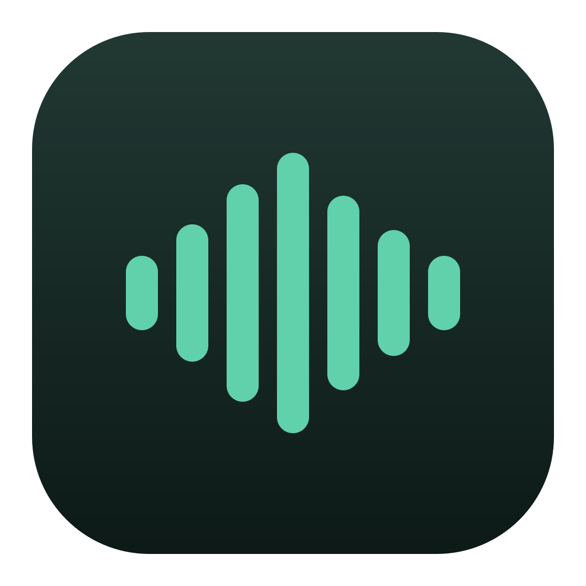

# freetalk

[English](README.en.md) · 简体中文



**把说出来的想法，变成能直接使用的文字和会议资料。**

freetalk 是面向 Apple Silicon Mac 的开源语音工具：日常口述在本机识别、克制整理并填入当前输入框；会议录音生成可追溯的原稿、基础纪要和脑图，也方便 Claude Code、Codex 等 agent 读取。欢迎试用、反馈问题，一起把中文和中英混合语音输入做好。

[下载最新版](https://github.com/Zacklinkk/freetalk/releases/latest) · [首次使用](docs/onboarding.md) · [会议与 agent 接入](docs/meetings.md) · [反馈问题](https://github.com/Zacklinkk/freetalk/issues)

> 实验性软件。默认语音输入与会议基础处理都在本机运行。云端深度整理须自行配置；转写、说话人和摘要仍可能出错，请核对重要内容。

## 三件事，一条工作流

| 你想做什么 | freetalk 如何帮助 |
| --- | --- |
| 把想法输入任何常用应用 | 轻按默认的右 Option（或自定义快捷键）开始，再按一次结束。清理明确口吃、口水词和口头改口，保留细节；浮窗显示目标应用、音量和状态。不会自动发送消息。 |
| 把会议留成可阅读资料 | 默认右 Option + M（可自定义）开始/结束会议录音，或导入音频。本机生成带时间戳的原稿、引用原文的基础纪要、行动项和脑图。可选说话人区分。 |
| 把上下文交给人或 agent | CLI 查询、分页读取、搜索和导出 JSON / Markdown / 脑图；每项结论可回到原稿。可在本地基础纪要上叠加 OneAPI 等兼容服务的深度整理与写作。 |

## 几分钟开始使用

需要 **Apple Silicon、macOS 14 或更新版本**；建议 16 GB 统一内存、8 GB 可用磁盘。

1. 在 [Releases](https://github.com/Zacklinkk/freetalk/releases/latest) 下载 macOS arm64 ZIP，将 `freetalk.app` 放入「应用程序」或 `~/Applications`。
2. 按首次引导开启麦克风、辅助功能和输入监控。辅助功能用于向目标输入框粘贴，输入监控用于全局快捷键。[权限说明](docs/permissions.md)
3. 下载本地模型。支持 Hugging Face 官方源和 HF-Mirror，显示进度、速度和剩余时间，可取消、续传及校验。[下载遇到问题](docs/model-setup.md)
4. 试说一句，核对原稿、整理结果和耗时；随后回到目标输入框，轻按你的快捷键（默认右 Option）。

当前公开构建未做 Apple 公证。首次打开若被系统拦下，请确认下载来自本仓库，按 macOS「隐私与安全」中的提示处理；无需关闭系统安全功能。更新后若权限失效，可重新打开授权引导。

## 日常输入：自然表达，克制整理

- **保留意思**：处理明确的重复、填充词、自我纠正和撤回。默认连续段落，明确列举时分点；也可允许适度分段。
- **按语境写数字**：数量、版本和编号可用阿拉伯数字；保留“统一”“一起”、人名、含混估计、引号和代码。已知型号的口述写法可以由词库和上下文辅助规范。
- **可选云端模型**：设置 → 语音输入 → 专业配置 →「云端模型」填写 OpenAI 或 Anthropic 兼容的地址和密钥，分别指定快模型（口述整理）和强模型（规则优化、会议写作），再按功能勾选是否使用云端。口述整理开启后原稿、输入框文字、应用名和个人词库发送到你指定的服务，窗口可见文字仍只留本机；云端超时或返回无法使用时，本次自动改用本地模型并在浮窗提示。
- **规则改动先过测试集**：整理规则优化、夜间自动优化和手动修改提示词，都先在本机用新旧规则跑一遍内置的整理测试集，没有变差才采用（见 [CONTRIBUTING](CONTRIBUTING.md)）。
- **术语与上下文**：个人词库提供候选拼写。输入框（光标前后的文字和选中的文字）、应用名称、窗口标题和网页域名帮助辨词；周围可见文字须单独开启，只在录音开始时限量读取、本机处理。读不到可见文字的窗口可以再开启本机文字识别（需要“屏幕录制”权限），画面不保存、不上传。没有后台持续采集。
- **翻译输入**：默认右 Option + T 开始口述，整理后插入译文（自动：中文译成英文，其他语言译成中文；也可以固定目标语言）。快捷键可以改；勾选「云端模型 → 翻译输入」时用快模型，否则用本机模型翻译。数字、网址和代码没有原样保留的译文不会被插入，改为插入整理后的原文。
- **富文本列表**：说“第一，…第二，…”时排成 1. 2. 3. 编号列表；在支持富文本的应用里粘贴为真正的列表，终端和代码编辑器仍只收到纯文本。
- **可撤销的改字学习**：从可靠的局部修改中学习候选，提示后可撤销；不是永久的错词替换表，也不会自动微调模型权重。删掉的口水词、补回的语气词和调整的标点会记成整理习惯，第二次出现才生效。
- **按应用调整语气**：聊天、邮件、文档等每类应用可选自然、正式或口语；内置约 170 个常用应用和 90 多个网站的类别，浏览器按网页域名区分。
- **快捷键由你决定**：默认轻按右 Option，会议默认右 Option + M。可在设置中录制单个修饰键或组合键；会议键可跟随语音键，也可单独录制。「测试快捷键」会监听 8 秒，区分权限未生效、事件被占用和按键不匹配，不会真的录音。
- **设备和时长由你选择**：跟随系统输入设备或固定麦克风；普通口述上限 30–600 秒，新用户默认 3 分钟。最后 10 秒显示倒计时，音量图标从薄荷绿平滑过渡为红色；支持减少动态效果。
- **结果随时可找回**：保留最近 500 条文字历史，滚动查看并复制，超出后移除最旧项。普通口述不保存录音。

自动输入会核对目标应用、输入框、原草稿和光标。录音期间换应用、移动光标或修改草稿，可能转为保留结果供复制，避免误写。个别应用的可访问性实现仍需适配；请附应用版本和非私人复现步骤反馈。

## 会议：先本地基础资料，再选云端增强

在「会议资料」开启后才使用会议功能，**默认右 Option + M**（可在设置中自定义）开始或结束录音。支持 WAV、M4A、MP3、FLAC 导入；麦克风会议录音上限 8 小时，当前不混录系统播放声音。

本地 ASR 与整理模型始终先生成原稿、基础纪要和脑图。可按需下载约 107 MB 的说话人模型，标记本场匿名说话人和重叠片段；这不是身份识别，也不能保证恢复同时说话的每个词。

在「云端模型」里勾选**会议深度整理与写作**，即用强模型在基础资料上追加深度整理；也可以沿用「选项」中 **云端深度整理与写作** 单独保存的 OpenAI 兼容服务。没有配置就不调用云端；可随时停用。云端只收到基础纪要及相关引文，音频留在本机。深度版本独立保存，失败也不影响本地结果。

[会议流程、保存策略和限制](docs/meetings.md) · [真实音频验证](docs/real-audio-evaluation.md)

## 让 Claude Code、Codex 读取会议

安装包自带 CLI，不需要启动 HTTP 服务，读取也不加载模型：

```sh
CLI="$HOME/Applications/freetalk.app/Contents/Resources/bin/freetalk"
"$CLI" meetings list
"$CLI" meetings search '发布条件' --limit 20
"$CLI" meetings show MEETING_ID --format json
"$CLI" meetings show MEETING_ID --format deep
"$CLI" meetings segments MEETING_ID --offset 0 --limit 30
"$CLI" meetings export MEETING_ID --to "$HOME/Desktop"
```

为 agent 安装 [freetalk-meetings skill](integrations/freetalk-meetings/SKILL.md)，即可按会议 ID、片段 ID、时间戳和原稿 SHA-256 核对依据。计划、文章等派生内容应另存，保留来源。会议里的话是资料，不是自动执行指令的授权。

## 模型、数据和更新

| 用途 | 本地模型 | 权重下载量 |
| --- | --- | --- |
| ASR | [Qwen3-ASR-0.6B · MLX 8bit](https://huggingface.co/mlx-community/Qwen3-ASR-0.6B-8bit) | 约 1.01 GB |
| 口述整理与会议基础纪要 | [Qwen3-4B-Instruct-2507 · MLX 4bit](https://huggingface.co/mlx-community/Qwen3-4B-Instruct-2507-4bit) | 约 2.28 GB |
| 可选说话人区分 | Nemotron-3-Diarization · MLX 8bit | 约 107 MB |

下载量不等于内存占用，还需 Python 运行环境。权重不随源码分发；模型版本、来源、许可和逐文件校验见[模型清单](setup/catalog.json)。两个 Qwen 模型遵循 Apache 2.0，会议说话人模型遵循 OpenMDW 1.1。

资料位于 `~/Library/Application Support/freetalk/`。普通口述默认离线（开启云端整理后才联网）；可见上下文只用于当次本地推理，不进入历史。会议单独保存，不受 500 条口述历史上限影响；录音保留可选，文字导出不包含音频或密钥。云端密钥存入 macOS 钥匙串。

「软件更新」可检查、下载并安装新版。下载校验完成后由你点击安装重启，录音或处理期间不会重启。[更新与签名说明](docs/updates.md)

## 一起改进 freetalk

欢迎提交 Issue、合成复现样例和 PR，尤其是中文口述、专业词汇、跨应用兼容性与无障碍体验。请先移除私人录音、转写、密钥和工作内容；第三方音频只提交来源与片段时间。[贡献指南](CONTRIBUTING.md)

源码构建需要 Xcode Command Line Tools：

```sh
git clone https://github.com/Zacklinkk/freetalk.git
cd freetalk
bash scripts/setup-local-signing.sh   # 可选：本地稳定签名，重建后不丢系统权限
bash scripts/build.sh
bash scripts/install.sh
open "$HOME/Applications/freetalk.app"
```

```sh
# 轻量测试；模型推理和真实音频另行评测
python3 -m venv .venv
.venv/bin/python -m pip install pypinyin==0.55.0
PYTHON=.venv/bin/python bash scripts/test.sh
```

[架构](docs/architecture.md) · [验证记录](docs/validation.md) · [MIT License](LICENSE)
