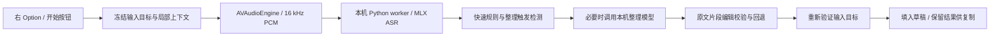

# 架构与编辑边界

AppKit 负责设置、引导、菜单栏、胶囊浮窗、设备管理、快捷键和跨应用输入。Python 子进程通过标准输入/输出上的逐行 JSON 接收 16 kHz PCM 与冻结的局部上下文；不监听端口。模型常驻，并在录音中按停顿或最长段限制提前转写。

文字整理采用「模型提出对原稿的局部编辑，程序校验后应用」，而不是要求模型自由改写全文。检查包含源片段、字面引用、数字、条件、否定、删除范围、未知替换与布局。明确改口可以应用新值，完整重述可以在有依据时撤回旧句；独立理由或条件仍需保留。拒绝的编辑和超时退回保守结果。

普通口述使用 [编辑提示词](../prompts/edit-plan.txt)。检测到「算了、刚才这句不要了、我重新说」等明确撤回信号时，同一个小模型使用 [撤回重述提示词](../prompts/restart-plan.txt)，不额外再跑一个总结模型。输入框文字只帮助辨词，不能引入未说出的要求或把背景当作新指令。

数字转换需要数量、单位、编号或型号等语境，例如「预算一百多万」→「预算100多万」，而「统一、唯一、第三方」保持中文；引用、代码、个人专名等受保护。这些是有边界的规则与语义检查，并不保证覆盖所有汉语歧义。

自动模式根据短句、填充词、重复、改口和多句结构决定是否调用模型。规则能完成的明确口吃或缩写规范，不必为展示“用了 AI”再增加推理。历史记录和试说结果显示真实路线。整理保留原意优先，默认不按每个句号换行；明确枚举才分点。

目标锁定与粘贴验证位于 `native/Input.swift`；学习位于 `native/Corrections.swift`；下载和迁移位于 `native/ModelSetup.swift` 与 `setup/`。设置和引导共用下载组件。引导试说走同一音频与模型管线，但在结果出口隔离外部插入和普通历史。

## 已知边界

- ASR 听错且没有可用拼写线索时，整理层不一定能恢复正确专名。
- 整理约束是工程检查，不是原意完全等价的数学证明。
- 部分应用没有提供可验证的无障碍文本或选区，此时需要手动复制。
- 蓝牙设备连接、唤醒和系统授权可能增加启动时间；预备输入节点不能消除硬件冷启动。
- 自动学习提供候选拼写，不包含保留音频、声学重打分或权重训练。
- 公共 CI 验证逻辑与构建，不验证真实麦克风和全部应用的输入兼容性。

