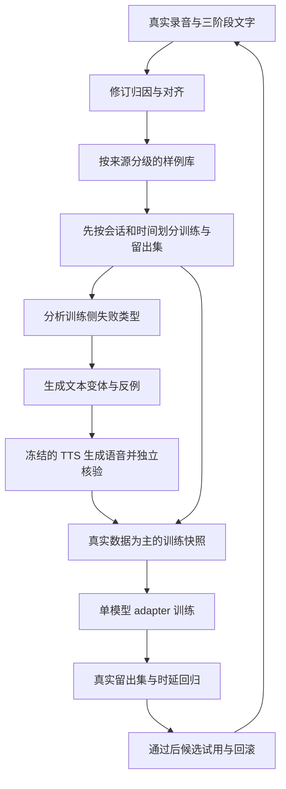

# 个人学习闭环：本机可行性与实现方案

## 2026-11-22 本机实现

在「设置 → 常用词与学习」开启需要的项目。学习留存、本地训练、本人音色、接电闲时训练和自动启用候选五项分别配置，初装默认全关。个人词库从改字学习的功能独立运行。

1. 录音和写入。每条获准留存的普通口述写入 `learning/samples/<id>/audio.wav` 和 `record.json`，后者包含 ASR 原稿、整理稿、观察到的修改、经用户核对的最终发送稿和各阶段耗时。跨应用插入由 macOS 辅助功能读回核验。成功才记录停止到输入的单调时钟耗时。
2. 筛选与分组。两种训练都用用户核对的最终稿。未改、追加长段、长度比超出 0.6–1.5、字符序列相似度低于 0.5 的样本剔除。按日期分出未来保留集，并排除重复原稿。ASR 还要求逐句与录音一致。用户说了又撤回的字句，若从最终稿删掉，只供整理学习。长达 20 秒以上的 ASR 样本需要先对齐，初版的声学训练只采用 0.3–20 秒单声道短片。
3. 拟合与验收。整理模型使用经线上编辑校验器回放可还原发送稿的标签。ASR 冻结声学编码器和量化基座，只更新最后四个解码层的低秩适配器。至少 8 条训练及另一天的 4 条验收样本才能产生候选。候选须降低保留集编辑错误、保持参考字符删除数不增长，并保留此前完全正确的样例。整理另跑内置回归集。首轮试用须用户确认；正式自动晋级需额外满足实际输入延迟及数据量门槛。运行结果见[本机实测](field-review-20261122.md)。
4. 接电闲时调度检查系统空闲、温度、内存、磁盘以及录音、会议和其他模型任务。训练每步保存权重和步数，切换到输入时按最近的完整步继续；重载完成后会核对同一光标再开始。基础模型可从设置恢复。普通口述历史默认保留 500 条，增加到 2,000 或 5,000 不会改变独立的训练样本。
5. 生成练习通过 `freetalk practice propose --category 英文缩写 --public-topic SFT --source-id <已核对训练样本> --count 4` 建议一批。用 `practice show <id>` 查看将发送的全部文本。`practice approve <id>` 需要用户输入本批编号。之后 `practice generate-text <id> --model <DUCC提供的Gemini模型名>` 只提交公开主题和任务。`practice synthesize <id> --reference-id <本人短录音> --my-voice --model-path <本机模型目录>` 使用本地 VoxCPM2 或 Qwen3-TTS Base 合成。合成独占本机推理资源，运行 CLI 合成前退出驻留的 freetalk。生成结果写入单独待核对目录。用 `practice accept-clip <id> --index 1 --set train` 逐条试听并确认，程序在本机对真实生成的 WAV 跑 ASR 取得原稿。只有确实与整理稿逐句对应时才加 `--audio-aligned`。有误的条目留在待核对区；合成训练例最多占总训练例的 20%，且与真实保留集去重。`--set challenge` 单独留作挑战集，不参与训练或真实保留集打分。当前生产版不自动批准练习。
6. `freetalk learning status` 给出样本筛选计数。`learning samples` 列出已核对样本的编号及所属数据集。`learning export-asr --output <新文件>` 导出已核对的音频路径和最终目标。`learning train`、`train-asr`、`trial`、`trial-asr`、`rollback` 和 `rollback-asr` 与设置中相应操作一致。日常使用优先从设置发起训练，应用会主动腾出推理内存。

## 2026-11-09 早期可行性实验（历史记录）

2026-11-09。状态：完成源码检查、上游方案核查与整理模型的极小训练探测；尚未实现或开启持续音频留存、最终发送稿采集、ASR/TTS 微调或自动训练。

## 结论

这台 Apple M4、10 核 GPU、16 GB 统一内存的 Mac 适合从个人数据积累和小规模 adapter 微调开始。三个模型应分时加载、分开训练、分别验收，共用证据库。日常语音输入优先；不把三模型并行训练或从头预训练作为目标。

先完成可信的数据链和整理模型 QLoRA，再用免训练音色克隆补充 ASR 难例，最后验证 ASR 与 TTS 的个人微调。推理能够运行不等于训练已经验证；权重下载量不等于训练内存。

## 本机证据与模型选择

| 任务 | 当前或候选模型 / 路径 | 本轮证据与边界 |
| --- | --- | --- |
| 日常 ASR | Qwen3-ASR-0.6B，MLX 8bit，目录约 1.01 GB | 已用于产品推理。本机安装的 mlx-audio 0.6.3 没有训练入口。官方提供 PyTorch 微调脚本；社区 MLX-Tune 有 Qwen3-ASR LoRA 实现，本机尚未跑训练。 |
| 文字整理 | Qwen3-4B-Instruct-2507，MLX 4bit，目录约 2.28 GB | MLX-LM 0.32.2 的 QLoRA 在本机完成 2 个更新步骤；详见下表。 |
| 音色克隆推理 | 首选试验 Qwen3-TTS-12Hz-0.6B-Base 的 MLX 8bit | 上游提供参考录音与准确参考文本的克隆接口，无需先训练。模型仓库合计约 1.99 GB，包含约 1.30 GB 主权重和语音 tokenizer；尚未在本机下载或实测。Base 与预置说话人的 CustomVoice 不混用。 |
| TTS 个人微调 | Qwen3-TTS-0.6B-Base + MLX LoRA | 官方有单说话人微调；Mac 社区有实现。需验证 codec、条件、梯度、adapter 导出与本机推理兼容性，不能直接承诺生产可用。 |

整理模型探测使用 4 条合成执行样例、batch 1、最大序列长度 256、最后 4 层、rank 8、梯度检查点、2 个更新步骤。模型权重只读，adapter 写入独立实验目录，未部署。

| 测量项 | 结果 |
| --- | ---: |
| 可训练参数 | 1.835 M，约全部参数的 0.046% |
| 第二次带内存统计的运行总时间 | 4.001 秒，包含加载、训练、微型校验与保存 |
| MLX 分配器峰值 | 2,651,652,210 字节，约 2.65 GB / 2.47 GiB |
| 进程 RSS 高水位 | 1,010,368,512 字节；与 MLX 内存不是可相加的独立数字 |
| adapter 文件 | 7,346,007 字节，约 7.35 MB |

第一次执行用于确认入口，第二次补测内存。微型校验复用一条执行样例，只测试代码路径；**不是独立质量验证**。短序列、少层数和两步训练不能外推到全部层、长录音或大数据训练的速度与峰值内存，更不能据此宣布识别已经改善。没有修改在用权重，也没有增加 Python 依赖。

## 数据应保存什么

当前产品保留最多 500 条 ASR 原稿、整理结果及耗时。普通口述音频不落盘；改字学习只观察本次插入区域，最多 90 秒，提取稳定的短词纠正，未保留完整最终稿，也没有证明消息已发送。已有文字记录可辅助错误分析，但无法恢复原音频。

开启新功能后，每次口述使用一个稳定的 sample ID，保存：

| 文件或字段 | 作用 |
| --- | --- |
| `audio/original.flac` | 本次真实录音，保留设备实际采样率；高质量 TTS 训练优先使用干净原录音 |
| `asr.json` | 原始 ASR 输出、分段时间、原音频哈希、模型版本；不被后续修订覆盖 |
| `cleanup.json` | 整理结果、局部修改计划、模型与提示词版本、耗时 |
| `edits.jsonl`、`final.txt` | 本次语音插入片段的用户修订版本及最后候选文本，标明来源和确认状态 |
| `labels/verbatim.txt` | 与声音内容对应、经过核对的逐字稿，是 ASR 和 TTS 的主要文本标签 |
| `labels/cleanup-target.json` | 保留原意的整理目标及经校验的修改计划，供当前整理接口训练 |
| `metadata.json` | 应用与必要场景、设备、采样率、模型/adapter/提示词哈希、质量与来源级别、数据划分、派生关系 |

原录音再派生 16 kHz ASR 输入；若硬件只提供较低采样率，记录真实情况，不通过上采样声称得到高保真录音。16 kHz、单声道、16bit PCM 每小时约 115 MB；48 kHz 同规格约 346 MB，FLAC 大小取决于音频。数据集应有独立的容量和保留期限，不与 500 条展示历史强行共用淘汰机制。

## 三种正确的训练配对

| 任务 | 输入 | 目标 | 不应直接当作金标的材料 |
| --- | --- | --- | --- |
| ASR | 真实录音及允许的辨词背景 | 与录音对应的核对逐字稿 | ASR 自己的未核对输出；删去口头改口、加入新要求后的最终发送稿 |
| 整理 | ASR 原稿、必要背景、候选编辑范围 | 用户核对的忠实整理稿，以及符合产品接口的编辑计划 | 小模型自己刚生成的整理稿；用户事后改变需求的部分 |
| TTS | 核对文本、该说话人的参考条件 | 同一句话对应的真实干净录音 / codec tokens | 最终改写文本搭配内容不同的旧录音；同一 TTS 自己的输出作为唯一真值 |

例子：声音是“先用十个，不对，改成十二个。保留日志”，最终稿是“先用12个。保留日志”。ASR 标签仍应保留说过的十个与改口过程；整理目标才是最后的12个。若用户又加上“明天完成”，这句没有声学依据，不能进入这条 ASR/TTS 标签。

数字的语音内容与书写形式分开评分，例如“一”和“1”的内容可以一致，而版本号格式可能不同。当前整理器返回修改计划或填充词 ID，不是总在生成完整改写稿；训练数据必须匹配实际部署接口，不能把纯文本目标直接塞进 JSON 计划接口。

未修改不等于已核对。保存来源等级：`model_output`、`observed_edit`、`user_confirmed`、`aligned_transcript`、`synthetic_verified`。只有满足对应任务条件的样例进入训练快照。

## 如何得到最终稿

从本次语音插入范围开始跟踪，保留原草稿前后边界与版本。不能把原有草稿、后续另一轮输入或用户刚贴入的无关文字归给这段录音。跨应用、换输入框、多段语音合并和重写大段内容会降低对齐置信度。

辅助功能 API 能在部分应用看到修改后的输入值，但“输入框清空”不能证明发送成功，Enter 也可能只是换行。支持明确发送回执的应用适配器可以标记 `sent_confirmed`；其他应用只记 `edited_candidate`，提供“确认这一版”或后续批量核对。截图 OCR 即使辅助取文，也不能单独证明发送成功或逐字对齐。

这一层默认关闭，按应用排除密码和其他敏感输入，仅采集用户主动开始的本次口述，不做全局键盘内容记录。未获得最终稿的样例仍可保留为未标注数据，但不能自动升级成 GT。

## 闭环与针对性扩充

先归因再决定是否训练：录音丢帧、麦克风切换、剪切边界、ASR 近音词、英文缩写、数字格式、整理误删、用户改变意图、跨应用输入失败是不同的问题。训练权重解决不了没有录到声音或文字未能粘贴的问题。

比如针对“如流知识库”，补充不同上下文、语速与停顿的正例，也保留“儒家”“水流”“服装”“浮窗”等容易被过度纠正的反例，以及 get/git、SFT、型号与普通数字表达。TTS 变体可以用自己的参考音色和其他获准使用的声音，避免只适应单一合成音色。

TTS→ASR 的语音数据扩充是已有研究路线，但循环一致不等于正确：同一 ASR 和 TTS 可以共享错误发音。生成音频需核对内容、裁切、时长、截断与读音，必要时使用不同的识别器或人工复听；模型判断只作辅助。真实标注是锚点，合成数据是补充，不让三种模型互相输出无限自证。

先划分真实数据，再做扩充。相同源录音、相似句子及其所有合成变体属于同一数据组，不能跨训练与测试。合成挑战集可检查专项问题，不能代替按天/会话/设备隔离的真实留出集。自动调参只看开发集；固定最终测试集限制重复试探，并定期加入新的未来真实样本。

## 验收与自动运行

| 模型 / 系统 | 必须观察的指标 |
| --- | --- |
| ASR | 中文 CER、英文 WER、术语错误、数字内容与格式、普通词反例、设备/噪声分层、遗漏与重复 |
| 整理 | 用户后续改字率、误删和新增事实、否定/条件/数字保持、口头改口、应保留不动的反例、结构偏好 |
| TTS | 可懂度、漏读/重复/截断、专业词发音、音色相似度和人工自然度；不只用训练中的 ASR 打分 |
| 产品 | 停止到输入的中位数和 P95、首次使用延迟、峰值内存、温度/能耗、训练打断后恢复耗时 |

所有模型保留基座与当前稳定 adapter。候选按模型单独验收，记录数据/代码/提示词版本；一次改变一个环节，之后再做组合回归。效果退化则保留旧版，不能因训练 loss 下降就替换。合并、量化导出的模型也要重新测质量与延迟。

建议将控制拆成独立开关：留存学习数据、允许本地训练、允许使用本人音色做合成扩充、自动闲时训练、自动启用通过验收的候选。初版均由用户主动开启；闲时训练与自动替换分开。

调度的初始方案：接电、空闲一段时间、无录音/会议/更新任务、内存和磁盘有余量、温度正常时才运行；同一时间只运行一个推理/训练任务。活动恢复后，在可恢复的步边界保存并释放模型，优先恢复口述。16 GB 机器的释放与重新预热会带来延迟，必须实测，不能承诺训练过程中随时零延迟录音。不通过修改系统内存限制或依赖大量交换空间来掩盖不足。

## 实现顺序

1. 可关闭的音频与版本留存、可靠片段边界、手动最终稿/逐字稿核对、来源等级和删除/导出。
2. 错误归因报告与真实留出集；词库检索和规则先解决不需要训练的问题。
3. 整理模型 QLoRA adapter 训练、离线对比、可回滚候选。先验证当前 JSON 编辑接口。
4. Qwen3-TTS Base 免训练音色克隆，生成少量专项 ASR 扩充；验证新 TTS 在 M4 上的峰值和耗时。
5. ASR LoRA 与 TTS LoRA 分别小试。冻结主要部分、短音频、batch 1 起步；若 Mac 路径兼容性或训练耗时不合适，再讨论可选远端 GPU，个人数据不自动上传。
6. 多轮人工监督证明有效后，开放闲时自动训练；自动启用仍须通过固定验收、候选试用与回滚。

## 查证来源

- [MLX-LM LoRA / QLoRA](https://github.com/ml-explore/mlx-lm/blob/main/mlx_lm/LORA.md)：本机文本模型微调使用的上游路径。
- [Qwen3-ASR 官方微调](https://github.com/QwenLM/Qwen3-ASR/tree/main/finetuning)：音频与文本 JSONL、PyTorch 训练。
- [MLX-Tune Qwen3-ASR 示例](https://github.com/ARahim3/mlx-tune/blob/9690fe1fed19c72f0810902b9c188d9a2625eb5b/examples/17_qwen3_asr_finetuning.py)：社区方案，固定检查版本 `9690fe1`；同时检查了 STT/TTS 的实际训练源代码。示例中的随机音频只适合执行检查，不是正确的 ASR 训练数据。
- [MLX-Audio Qwen3-TTS 克隆接口](https://github.com/Neywa-Labs/mlx-audio/blob/main/mlx_audio/tts/models/qwen3_tts/README.md)：Base、参考音频与准确参考文本。
- [Qwen3-TTS 0.6B Base MLX 8bit 文件](https://huggingface.co/mlx-community/Qwen3-TTS-12Hz-0.6B-Base-8bit/tree/main)：下载量包含语音 tokenizer。
- [Qwen3-TTS 官方微调](https://github.com/QwenLM/Qwen3-TTS/blob/main/finetuning/README.md)：单说话人数据、目标真实音频、参考音频和文本。
- [mlx-audio-train](https://github.com/akashicMarga/mlx-audio-train)：另一条社区 TTS LoRA 路径，检查版本 `ffbb489`，未安装或执行。
- [Listening while Speaking](https://arxiv.org/abs/1707.04879) 与 [SpeeChain](https://arxiv.org/abs/2301.02966)：ASR/TTS 闭环及合成数据扩充研究；不构成本机产品自动持续变好的保证。
